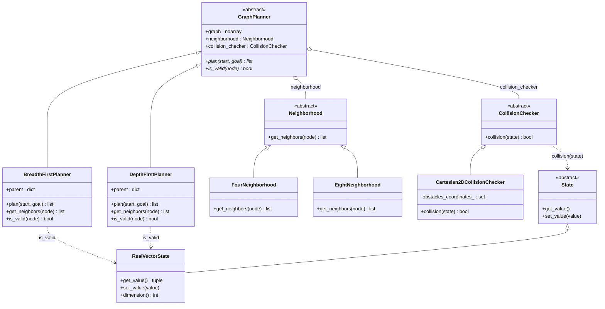

# UML Class Diagram — Graph Planners

This diagram documents the abstract/concrete (Strategy) design used by
[`BreadthFirstPlanner.py`](../scripts/planners/BreadthFirstPlanner.py) and
[`DepthFirstPlanner.py`](../scripts/planners/DepthFirstPlanner.py), together
with the abstract collaborator classes they depend on (`Neighborhood`,
`CollisionChecker`, `State`) and the concrete implementations of those
collaborators found in the repository.

Mermaid was chosen over Graphviz/Pyreverse because it lets the relationships
be curated by hand (only class names and key methods, per the project's "less
abstraction, more clarity" style) instead of auto-dumping every
method/attribute, and it renders natively in GitHub and most Markdown
previewers without extra tooling:

## Notes on the design

- **`GraphPlanner`** is an `ABC` that stores the occupancy grid (`0` free,
  `1` obstacle), a `Neighborhood` and a `CollisionChecker`, and declares two
  abstract hooks — `plan(start, goal)` and `is_valid(node)` — that each search
  algorithm implements. `plan()` returns the list of nodes from the start to
  the goal, both included, or an empty list if there is no path.
- **`Neighborhood` and `CollisionChecker`** are Strategy-pattern interfaces
  injected into the planner via its constructor, so a planner is agnostic to
  the connectivity of the grid (`FourNeighborhood` or `EightNeighborhood`) and
  to how a free cell is decided.
- **`BreadthFirstPlanner` and `DepthFirstPlanner`** run the same search over
  the same collaborators; they differ only in the frontier: a FIFO queue
  (fewest steps) versus a LIFO stack (a valid path, usually much longer). Both
  store the discovered nodes and their predecessors in `parent` while
  planning. Its insertion order is the discovery order that the web visualizer
  animates, and it is also the visited set.
- **Coordinate convention.** Graph nodes are `(row, column)` indices into the
  map matrix, while `Cartesian2DCollisionChecker` stores obstacles as
  `(x, y) = (column, row)`. `is_valid()` therefore builds the
  `RealVectorState` as `(column, row)` before calling `collision()`. The
  command line and the web visualizer take start and goal as `(x, y)` and swap
  them into `(row, column)` before planning.
- **`RealVectorState`** is the only concrete `State`; the planners use it only
  to query the collision checker, never to store the path.
- **Web visualizer.** `webvis/server.py` keeps two registries, `PLANNERS`
  (`bfs`, `dfs`) and `NEIGHBORHOODS` (`four`, `eight`), that map the query
  parameters of `GET /plan` to these classes, so a new planner or neighborhood
  is added by registering one more entry.
- **Duplication to be aware of.** `get_neighbors()` and `is_valid()` are
  implemented identically in both planners rather than in `GraphPlanner`.
  Moving them to the base class would be a small refactor if more planners are
  added.
